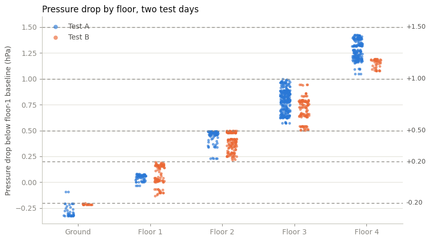
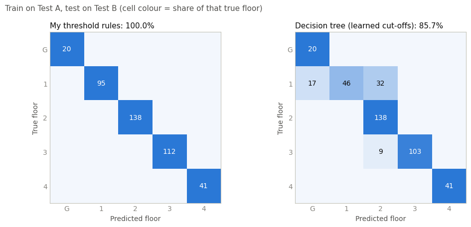

<h1 align="center">Floor Detection: Threshold Rules vs a Learned Model</h1>

<b>A mini machine learning experiment on my SmartLocator BluPixels pressure data</b> 
<i>CT125 final-year project &nbsp;|&nbsp; ESP32 + BME280 + Flutter + Firebase BLE item tracker</i>

---

## At a glance

**Question:** my firmware detects the floor with threshold rules on the pressure difference. If a model *learns* its own cut-offs from labelled data, does it do better?

**Answer:** **not on this data.** My threshold rules held up (**99.7% to 100%**). A decision tree trained on one test day did **not generalise** to the other day (**85.7%**), because the training day did not cover enough variation.

**Why it is still useful:** it shows exactly what a learned model would need: *more diverse data* (different days, weather and baseline floors).

| Method | Train A, test B | Train B, test A |
|:---|:---:|:---:|
| **My threshold rules** | **100.0%** | **99.7%** |
| Decision tree | 85.7% | 99.7% |
| Random forest | 85.7% | 99.7% |

> [!NOTE]
> This is a first prototype experiment and still in progress. The dataset is small (see [Limitations](#5-limitations)), so read the numbers as a prototype result, **not proof**.

### Contents

1. [Background](#1-background-how-floor-detection-works-in-smartlocator)
2. [Data](#2-data)
3. [Method](#3-method)
4. [Results](#4-results)
5. [Limitations](#5-limitations)
6. [Next steps](#6-next-steps)
7. [How to run](#7-how-to-run)
8. [Files](#8-files)
9. [Tools and AI assistance](#9-tools-and-ai-assistance)
10. [Glossary](#10-glossary)

---

## 1. Background: how floor detection works in SmartLocator

- The user picks the floor they are on (Ground, Floor 1 to Floor 4). **Any floor can be the baseline floor.**
- The ESP32 reads the BME280 pressure every 500 ms and applies a **3-stage filter** (median, moving average, EMA).
- Once the reading is stable (at least 80 samples, range below 0.1 hPa, standard deviation below 0.03 hPa), the current pressure is saved as the **baseline pressure**. A *dynamic* baseline is used because atmospheric pressure drifts with weather, ventilation and HVAC.
- While tracking, the system computes the **pressure difference** from the baseline and maps it to the number of floors moved:

| Pressure difference (absolute value, hPa) | Floors moved |
|:---|:---:|
| below 0.20 | same floor |
| 0.20 to 0.50 | 1 floor |
| 0.50 to 1.00 | 2 floors |
| 1.00 to 1.50 | 3 floors |
| above 1.50 | 4 floors |

- Pressure **drops** when going **up** and **rises** when going **down**. The result is kept between Ground and Floor 4.
- These ranges came from analysing my earlier test readings and were then **field-tested in different weather and times of day**.

In this experiment, `delta_hPa = current pressure - baseline pressure`. *A falling pressure (negative delta) means going up.*

## 2. Data

- **Source:** my own pressure test logs, typed into a spreadsheet (two test sessions on different days, one building, one device).
- **Both sessions used Floor 1 as the baseline floor.**
- **Test A flow:** Floor 1, Ground, Floor 2, Floor 3, Floor 4, Floor 3.
- **Test B flow:** Floor 1, Floor 2, Floor 3, Floor 2, Floor 3, Floor 4, Floor 3, Floor 2, Floor 1, Ground, Floor 1.
- **Feature:** `delta_hPa`. **Label:** the floor I was physically on.
- BLE proximity (RSSI) is not part of this experiment because I did not record data for it.

**Cleaning**

| Step | Readings |
|:---|---:|
| Readings in total | 1152 |
| Left out: walking on the stairs (highlighted in the sheet, true floor unclear) | 91 |
| Left out: mistyped readings | 2 |
| **Readings used** | **1059** (Test A: 653, Test B: 406) |

**Readings used, per floor**

| Floor | Test A | Test B |
|:---|---:|---:|
| Ground | 40 | 20 |
| Floor 1 | 62 | 95 |
| Floor 2 | 85 | 138 |
| Floor 3 | 281 | 112 |
| Floor 4 | 185 | 41 |

## 3. Method

1. **My threshold rules** (the baseline): the five bands above, written as a function.
2. **Decision tree** (ML): a chain of yes/no questions on `delta_hPa`. The cut-offs are *learned* from training data by scikit-learn (`max_leaf_nodes=5`, so five zones for five floors).
3. **Random forest** (ML): 200 decision trees that vote (`n_estimators=200`, `min_samples_leaf=5`).
4. **Fair test:** train on one day, test on the *other* day, in both directions (Train A, test B and Train B, test A).
5. **Metrics:** **accuracy** (correct readings divided by total) and a **confusion matrix** (which floor is predicted for each true floor).

## 4. Results

### 4.1 Accuracy

| Method | Train A, test B (406 readings) | Train B, test A (653 readings) |
|:---|:---:|:---:|
| **My threshold rules** | **100.0%** | **99.7%** |
| Decision tree (learned cut-offs) | 85.7% | 99.7% |
| Random forest | 85.7% | 99.7% |

### 4.2 What the data looks like

Each dot is one reading. Higher floors have a bigger pressure drop below the Floor 1 baseline. Dashed lines are my threshold boundaries.

  

<i>Figure 1: pressure drop by floor for Test A (blue) and Test B (orange).</i>

### 4.3 Where each method goes wrong (train A, test B)

Rows are the true floor, columns are the predicted floor. The diagonal is correct.

  

<i>Figure 2: my rules (left) are all on the diagonal. The tree (right) confuses Floor 1 with Ground and Floor 2.</i>

### 4.4 What the results show

- **My rules held up.** 2 wrong readings out of 1059. Both are the *same reading* (delta +0.091) at the start of the "to Ground" stay, so that label may be rough.
- **The tree learned similar cut-offs for the upper floors, but not for Floor 1.**

| Cut-off (delta, hPa) | My rules | Tree trained on A | Tree trained on B |
|:---|:---:|:---:|:---:|
| Floor 4 / Floor 3 | -1.00 | -1.022 | -1.01 |
| Floor 3 / Floor 2 | -0.50 | -0.533 | -0.50 |
| Floor 2 / Floor 1 | -0.20 | -0.156 | -0.206 |
| Floor 1 / Ground | +0.20 | **+0.061** | +0.167 |

- **Why the tree failed on Test B.** The pressure on Floor 1 *drifted much more* on Test B than on Test A:

| Floor 1 readings | Lowest delta | Highest delta |
|:---|:---:|:---:|
| Test A | -0.081 | +0.032 |
| Test B | **-0.197** | **+0.131** |

The tree trained on A learned a Floor 1 zone of about -0.156 to +0.061. On Test B, **17** Floor 1 readings were predicted as Ground and **32** as Floor 2 (49 of 95 Floor 1 readings wrong). My rules use a Floor 1 zone of +/-0.20, which covered the whole drift.

- **The reverse direction supports this.** Trained on B (the wider range), the tree scored **99.7%** on A.
- **The random forest equals the tree** because there is only one feature, so 200 trees learn almost the same thing and voting adds nothing.

### 4.5 Conclusion

1. The experiment **supports** my pressure-difference ranges as reasonable rules for this data.
2. A learned model needs **diverse** training data (different days, weather and baseline floors), *not just more rows of the same day*. Readings next to each other are near-duplicates, so the number of independent tests is small.

## 5. Limitations

- **Small data:** one building, one device, 17 stays. Treat the numbers as a prototype result.
- **Only Floor 1 as baseline.** The model only learned "distance from Floor 1". The real system allows any baseline floor, which needs data from other baseline floors.
- **The "above 1.50 hPa = 4 floors" band was never exercised.** The largest change in the data is about 1.42 hPa.
- **Thin margins in places.** On Test B, some readings sit within 0.001 to 0.003 hPa of a boundary (for example Floor 1 up to 0.197 against the 0.20 line). The rules score 100% here, but that is not a large safety margin.
- **Possibly optimistic rules score.** If my ranges were tuned on readings similar to these, the score is not a clean "untrained" baseline. My real-world tests in different weather and times of day are stronger evidence than this notebook.
- **Filtered values.** The logged values are the firmware's filtered pressure. The filter snaps to the raw reading when it jumps by more than 0.10 hPa, which is the likely source of the sudden ~0.10 hPa steps in the data.
- **One feature only** (`delta_hPa`). With one feature, a tree is just learning cut-offs.
- **Some labels may be rough:** in a few stays the pressure keeps changing by about a floor's worth in rows that are not marked as moving.

## 6. Next steps

- Log new data with the floor labelled as I go, across **more days, weather conditions and baseline floors**.
- Add features such as the **recent rate of pressure change** (to tell weather drift from a real floor change).
- Use **cross-validation by day** instead of a single train/test split.
- Compare the **time taken** to show the correct floor, not only accuracy.
- Longer term: if a learned model clearly beats the rules, explore running it on the ESP32 with TinyML tools (Edge Impulse, TensorFlow Lite for Microcontrollers). A one-feature tree would simply become if/else code, so this only makes sense once there are more input features.

## 7. How to run

1. Open `smartlocator_floor_ml_mini_experiment.ipynb` in [Google Colab](https://colab.research.google.com/) (or Jupyter).
2. Upload `pressure_labelled.csv` to the same folder as the notebook (in Colab, use the upload icon in the Files panel so it lands in `/content`).
3. Run all cells.

**Requirements:** Python 3, pandas, numpy, matplotlib, scikit-learn.

## 8. Files

| File | What it is |
|:---|:---|
| `smartlocator_floor_ml_mini_experiment.ipynb` | The notebook (code, charts, results, notes) |
| `pressure_labelled.csv` | Cleaned and labelled pressure readings (`use_for_ml` marks the 1059 used rows) |
| `delta_by_floor.png` | Pressure drop by floor, both test days |
| `confusion_matrices.png` | Rules vs decision tree on Test B |

## 9. Tools and AI assistance

- Python, pandas, NumPy, matplotlib, **scikit-learn** (the ML library that trains and predicts), Google Colab (runs the notebook).
- I used an AI assistant (Claude) to help clean the logged data, write the notebook code and explain results. I designed the test procedure, supplied and labelled the data, and wrote up the interpretation and limitations above.

## 10. Glossary

| Term | Meaning |
|:---|:---|
| **Pressure difference (delta)** | Current pressure minus the baseline pressure, in hPa |
| **Cut-off** | A dividing line on delta between one floor and the next |
| **Decision tree** | A chain of yes/no questions that ends in a prediction. Here the questions are cut-offs on delta |
| **Random forest** | Many decision trees that vote; the majority answer wins |
| **Training / testing** | The model learns from the training data, then is scored on data it has not seen |
| **Accuracy** | Correct predictions divided by total predictions |
| **Confusion matrix** | A table of true floor (rows) against predicted floor (columns); the diagonal is correct |
| **Generalise** | Keep working on new data that differs from the training data |
